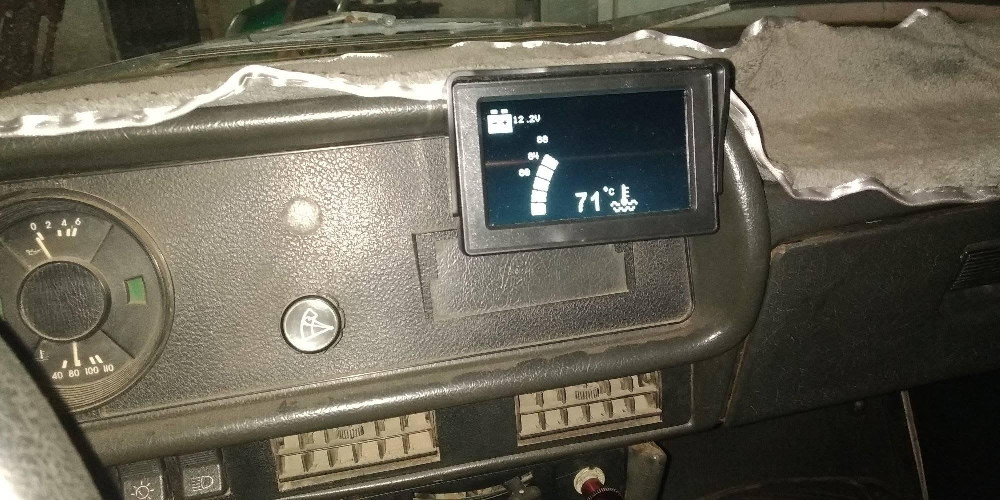
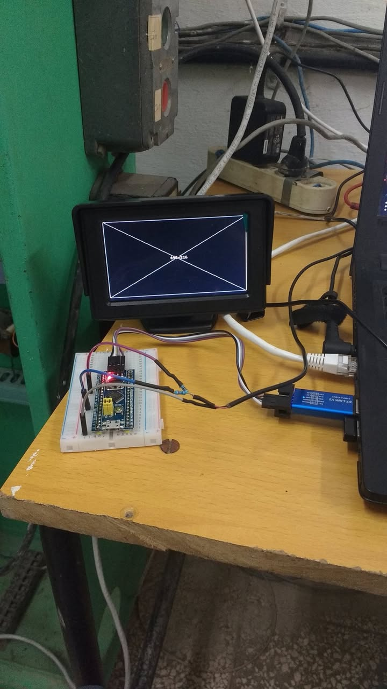

# Moskvich — instrumento digital con video NTSC generado por un STM32

Tablero digital para un Moskvich: un STM32F103 **genera la señal de video NTSC por
software** y la inyecta en el monitor de la cámara de retroceso del carro. En esa
misma pantalla, que el resto del tiempo está apagada, se muestran la temperatura
del refrigerante, el voltaje de la batería, las RPM y la velocidad y hora del GPS.

Sin pantalla propia, sin módulo de display: el único hardware de video es un par de
resistencias y un conector RCA.



Es una variante del controlador de electroventilador
[`electro`](https://github.com/vladimir1284/electro), hecho con Casanova para un
Lada 2107. De ahí vienen el controlador, la máquina de estados, el filtro de media
móvil, el menú y la EEPROM. Esta variante —el video, el GPS y el cuentarrevoluciones—
es trabajo mío.

---

## Generación de video

La librería [TTVout](https://github.com/Tamakichi/ArduinoSTM32_TTVout) de **Tamakichi**
(port a STM32F1 de la TVout de Myles Metzer) produce NTSC compuesto sin hardware de
video dedicado:

- **Sincronismo**: PWM del canal 2 de `TIMER2`, desbordamiento cada 63.5 µs (1524
  cuentas a 24 MHz) → pin `PA1`.
- **Luminancia**: el framebuffer se vuelca por **SPI1 con DMA** → pin `PA7` (MOSI).
- Las dos señales se suman con una red resistiva a los 75 Ω de la entrada compuesta.

Resolución en uso: `SC_224x108`. En el código queda comentada `SC_448x216`, que es
la que aparece en la foto de banco. El ajuste de encuadre del monitor concreto está
en `TV.adjust(0, -9, 8)` dentro de `moskvich.ino`.



---

## Qué muestra la pantalla

- Temperatura del refrigerante: valor numérico grande, icono de termómetro y una
  barra escalonada graduada en `T1`, `T1+H` y `T1+2H`.
- Voltaje de la batería con icono y parpadeo de alarma.
- RPM del motor.
- Velocidad en km/h y fecha/hora, desde el GPS.
- Etiquetas de estado (`I`, `II`, `AT`) heredadas del controlador de ventilador.

## Entradas

| Entrada | Cómo se mide |
|---|---|
| Temperatura | NTC en divisor con 6.75 kΩ (`RTEMP`), Steinhart–Hart, media móvil de 50 muestras |
| Voltaje | divisor 4.7 kΩ / 1 kΩ (`VOLT_FACTOR = 0.00459228515625`), mismo filtro |
| RPM | conteo de flancos con validación de 3 lecturas iguales (`NCHECK`), `rpm = flancos · 15000 / ms` |
| GPS | módulo NEO-6M por `Serial3` a 9600 bps, decodificado con TinyGPS++ |

Los coeficientes de Steinhart–Hart de esta variante
(`0.4613304466e-3`, `2.883224537e-4`, `3.748458244e-7`) no son los de `electro`: el
termistor es otro. `tools/computeR.py` es el script de tanteo que se usó para
despejar la resistencia a una temperatura dada — ojo, quedó con los coeficientes
viejos, los de `electro`.

---

## Pinout

| Señal | Pin |
|---|---|
| Sincronismo de video (TIMER2 CH2) | `PA1` |
| Señal de video (SPI1 MOSI, DMA) | `PA7` |
| NTC | `PA0` |
| Voltímetro | `PA2` |
| Cuentarrevoluciones | `PA15` |
| Pulsador de configuración | `PA10` |
| Tono del zumbador | `PB15` |
| Activación del zumbador | `PB6` |
| Relé 1ra velocidad | `PA9` |
| Relé 2da velocidad | `PA8` |
| GPS (`Serial3`) | `PB10` / `PB11` |

El voltímetro se movió de `PA1` (que es donde lo tiene `electro`) a `PA2` porque
`PA1` lo ocupa el sincronismo de video.

Esquemático en Fritzing: [`hardware/esquematico_moskvich.fzz`](hardware/esquematico_moskvich.fzz).
Incluye la Blue Pill, el módulo GPS NEO-6M, el conector RCA, el termistor, un
sensor piezoeléctrico y la red resistiva de video. Las hojas de datos de los
componentes de potencia y acople están en [`hardware/datasheets/`](hardware/datasheets).

---

## Parámetros configurables

Mismo menú de un solo pulsador que `electro`, con los valores en EEPROM emulada
sobre flash:

| Parámetro | Rango |
|---|---|
| Temperatura de disparo | 75 – 85 °C |
| Histéresis | 3 – 6 °C |
| Calibración de temperatura | −5 – +5 °C |
| Calibración de voltaje | −5 – +5 (×0.1 V) |

Umbrales del voltímetro: escala 12 – 14.5 V, alarma por encima de 14.94 V.
Hay además un modo **Prueba** que recorre temperaturas y voltajes simulados.

---

## Estado del código

El equipo está instalado y en uso. El código de este repositorio es el que había en
la carpeta de trabajo, tal cual, y **no coincide exactamente con lo que está
corriendo en el carro**. Conviene saber qué está terminado y qué no:

1. **No compila tal cual.** `ElectroController::handleAlarm()` usa `PIN_MOV` y
   `ALARM_DELAY`, que no están definidos en ninguna parte del proyecto. Es una
   alarma antirrobo a medio hacer, por el sensor piezoeléctrico que sí aparece en el
   esquemático. La llamada a `handleAlarm()` desde `handleBuzzer()` tampoco está
   comentada. Para compilar hay que definir los dos símbolos o quitar la función.
2. **El GPS no arranca.** `gps_controller.setup()` nunca se llama desde `setup()`,
   así que `Serial3` no se inicializa y velocidad, fecha y hora se quedan en cero.
   El código de decodificación está completo; falta la llamada.
3. **Las entradas A y B están desconectadas.** `PIN_A` y `PIN_B` valen `-1` y
   `acStatus` está comentado. La variable `reverse` (señal de marcha atrás, que
   haría sonar el zumbador) nunca se activa.
4. **Las salidas de ventilador sobran.** La máquina de estados de cuatro estados y
   los relés de `PA8`/`PA9` vienen de `electro`; este Moskvich no tiene
   electroventilador.

En [`firmware/compilado-2021-12/`](firmware/compilado-2021-12) está preservada la
versión que de verdad se compiló: `controller.cpp` y `controller.h` tal como quedaron
en el build del 4 de diciembre de 2021 (sin `handleAlarm`, los dos únicos ficheros
que difieren del resto del código) y el binario `moskvich.ino.bin` del 16 de
diciembre de 2021.

---

## Compilación

Sketch de Arduino con el core
[stm32duino STM32F1](https://github.com/rogerclarkmelbourne/Arduino_STM32).

- Placa: `stm32duino:STM32F1:genericSTM32F103C`
- Variante: `STM32F103CB`
- Reloj: 72 MHz
- Carga: **ST-Link**

Librerías:

- [`TTVout`](https://github.com/Tamakichi/ArduinoSTM32_TTVout) y su dependencia `TNTSC` (Tamakichi)
- `TinyGPS++`
- `EEPROM` (la del core STM32F1)

```
firmware/moskvich/moskvich.ino
```

---

## Estructura del repositorio

```
firmware/moskvich/
├── moskvich.ino        Sketch principal
├── controller.{h,cpp}  Máquina de estados, NTC, voltaje, zumbador
├── hmi.{h,cpp}         Pantalla: aguja, barra, iconos, etiquetas
├── configs.{h,cpp}     Menús, pinout, constantes, EEPROM
├── gps.{h,cpp}         Lectura del NEO-6M con TinyGPS++
├── rpm.{h,cpp}         Cuentarrevoluciones por conteo de flancos
├── button.{h,cpp}      Antirrebote del pulsador
├── signal.{h,cpp}      Validación temporizada de entradas externas
├── mean_filter.{h,cpp} Media móvil de 50 muestras
├── tpila.{h,cpp}       Pila de enteros
├── Arial_round_16x24.* Fuente de 16×24 para los dígitos grandes
├── schematic.{h,cpp}   Mapa de bits de 120×96 del esquemático
├── TVOlogo.{h,cpp}     Mapa de bits del logo
├── bar_points.h        Puntos de la barra indicadora
└── electro.bk          Copia del sketch original de electro, antes del port a video

firmware/compilado-2021-12/   Fuentes y binario del build que está en el carro
hardware/                     Esquemático Fritzing y hojas de datos
tools/computeR.py             Tanteo de la curva del termistor
docs/img/
```

## Licencia

MIT — ver [LICENSE](LICENSE).
